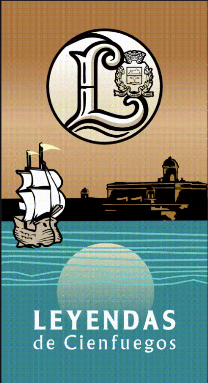
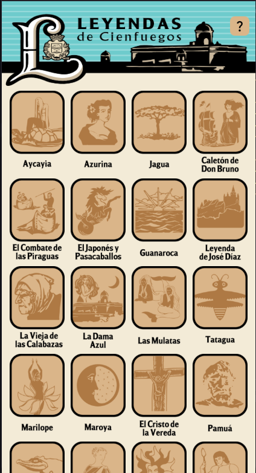
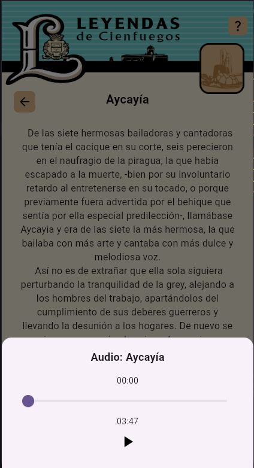

# Cienfuegos Folklore

**Cienfuegos Folklore** es una aplicación móvil desarrollada por **Alexis Manuel Hurtado Garcia** para Alabbi S.U.R.L. que reúne las leyendas y relatos populares de la ciudad de Cienfuegos, Cuba. Permite leer cada una de las 20 leyendas y escucharlas narradas, con una interfaz ilustrada y sencilla.

## Tech Stack

<div style="display: flex; align-items: center;">
  
  
</div>

## Características

- **Splash animado**: splash nativo seguido de una animación de presentación al abrir la app.
- **Catálogo de leyendas**: cuadrícula ilustrada con las 20 leyendas cargadas desde `assets/data/legends.json`.
- **Detalle de leyenda**: texto completo de cada leyenda con transición Hero de su ilustración.
- **Reproductor de audio**: narración de cada leyenda con reproducir/pausar, barra de progreso y búsqueda.
- **Créditos**: diálogo animado con los créditos de diseño y desarrollo.
- **Funciona sin conexión**: todo el contenido (texto, imágenes y audio) va incluido en la app.

## Dependencias

### Dependencias Principales

- `animated_splash_screen`: splash animado de presentación.
- `flutter_native_splash`: splash nativo con la imagen de la app.
- `audioplayers`: reproducción de la narración de las leyendas.
- `cupertino_icons`: iconos de estilo iOS.

### Dependencias de Desarrollo

- `flutter_test`: pruebas unitarias y de widgets.
- `flutter_lints`: reglas de análisis estático recomendadas.
- `flutter_launcher_icons`: generación del icono de la app.

## Cómo usar

1. Clona el repositorio:
   ```bash
   git clone https://github.com/A4GOD-AMHG/Flutter-FolkloreCienfuegos.git
   cd Flutter-FolkloreCienfuegos
   ```
2. Instala las dependencias (requiere Dart `^3.6.0`):
   ```bash
   flutter pub get
   ```
3. (Opcional) Regenera icono y splash nativo:
   ```bash
   dart run flutter_launcher_icons
   dart run flutter_native_splash:create
   ```
4. Ejecuta la app:
   ```bash
   flutter run
   ```
5. Compila el APK:
   ```bash
   flutter build apk --split-per-abi
   ```

No se necesitan variables de entorno.

## Estructura del Proyecto

```
lib/
├── main.dart                      # Arranque, splash nativo y animado, MaterialApp
├── models/
│   └── legend.dart                # Modelo Legend (título, contenido, imágenes, audio)
├── services/
│   └── legend_repository.dart     # Carga las leyendas desde legends.json
├── screens/
│   ├── home_screen.dart           # Cuadrícula de leyendas
│   └── legend_detail_screen.dart  # Texto de la leyenda y botón de audio
└── widgets/
    ├── audio_player.dart          # Reproductor de la narración
    ├── info_button.dart           # Botón "?" que abre los créditos
    └── info_modal.dart            # Diálogo animado de créditos
assets/
├── audio/                         # Narraciones en MP3
├── data/legends.json              # Textos y rutas de cada leyenda
├── icons/                         # Ilustraciones de cada leyenda
└── images/                        # Cabeceras, splash e identidad
test/
└── widget_test.dart               # Pruebas del modelo y de legends.json
```

## Capturas de Pantalla

<div align="center" style="display: flex; justify-content: center; gap: 30px; flex-wrap: wrap; margin: 30px 0;">
  
  
  
</div>

## Licencia

Este proyecto es de uso personal y educativo. Todos los derechos reservados.

## Autor

**Alexis Manuel Hurtado Garcia** - [GitHub](https://github.com/A4GOD-AMHG)
